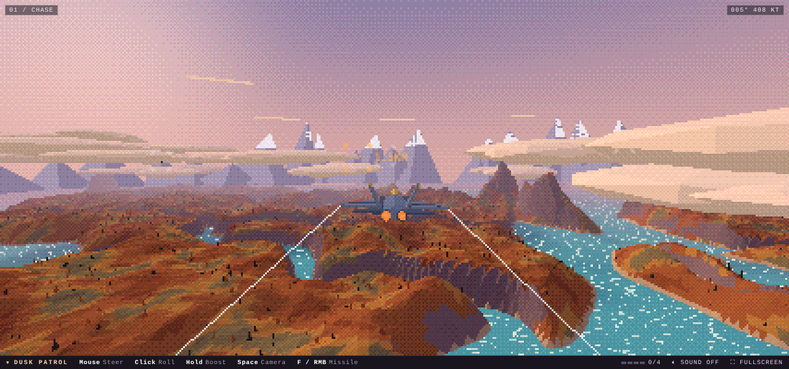
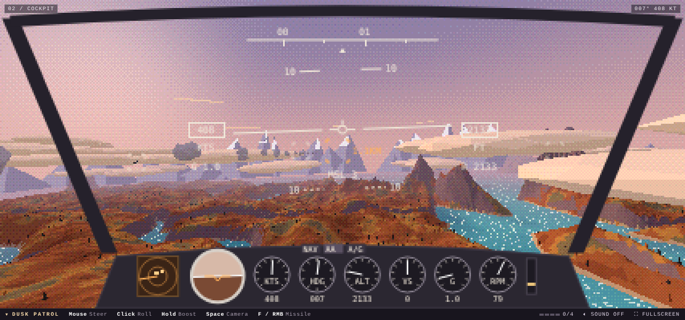
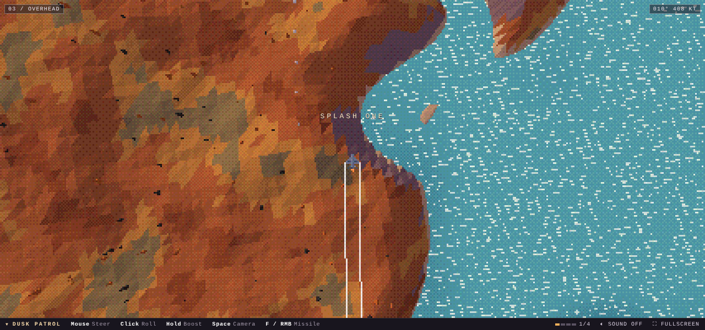

# Dusk Patrol

### ▶ [Play it in your browser](https://game-demo-1.vercel.app/)

A small stylized flight demo for the browser: fly a low-poly jet over a procedurally
generated dusk landscape, switch cameras, and fight waves of enemy jets that shoot back.
Everything — terrain, jets, clouds, sounds — is generated in code; there are no asset files.



| Cockpit | Overhead |
|---|---|
|  |  |

Built with [Three.js](https://threejs.org) and [Vite](https://vite.dev).

## Run it
You need **Node.js 18+** (check with `node -v`; get the LTS from https://nodejs.org).

```bash
npm install     # first time only
npm run dev     # opens http://localhost:5173 in your browser
```

## Controls
| Input | Action |
|---|---|
| Mouse position | Steer (the jet follows the cursor: left/right banks, up/down pitches) |
| Click (quick) | Barrel roll (also Q / E) |
| Hold left mouse | Boost (also Shift) |
| Space | Switch camera: Chase → Cockpit → Overhead |
| F / right-click | Fire missile (locks the bracketed enemy ahead) |
| M | Sound on/off (also the button in the bottom bar) |

## How to play
- Shoot down all 4 enemies to clear a wave; each wave is faster and more aggressive.
- Enemies fire homing missiles. On **MISSILE** warning, turn hard, or **barrel roll at the last
  second** (when it's close) to shake the lock.
- Your hull takes 3 hits and slowly repairs when you're out of the fight. Don't fly into the
  ground — watch for **PULL UP**.

## Tests
```bash
npm test
```

See `docs/PROGRESS.md` for status and `CLAUDE.md` for how the project is organised.
